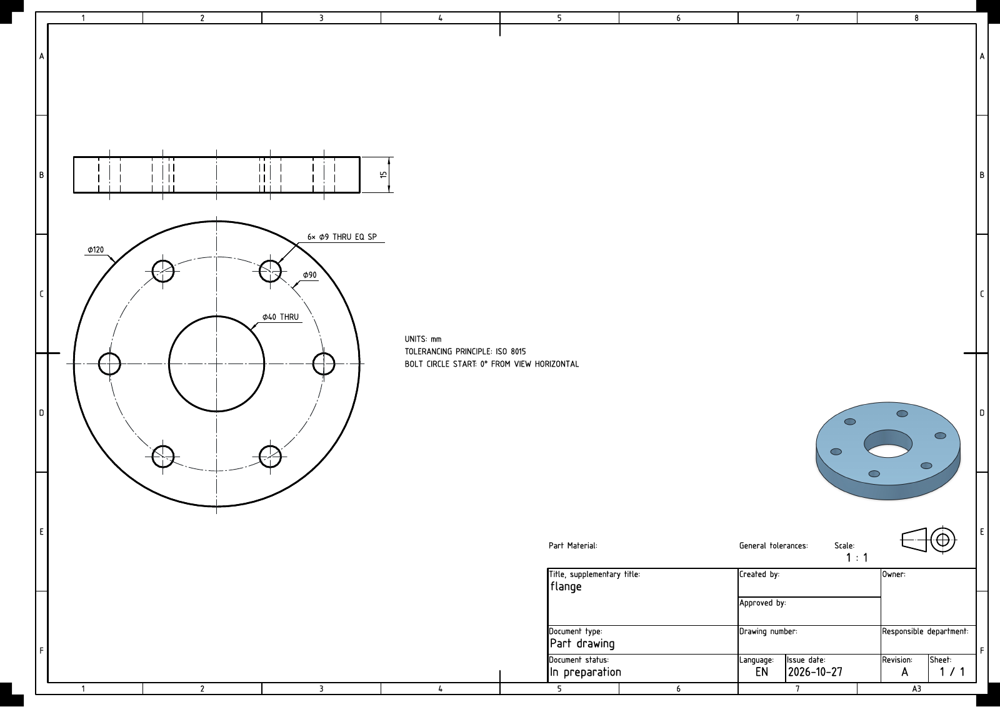
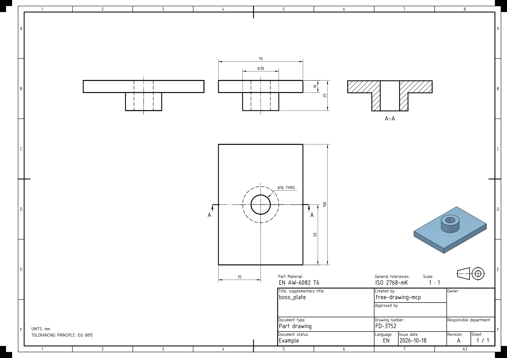
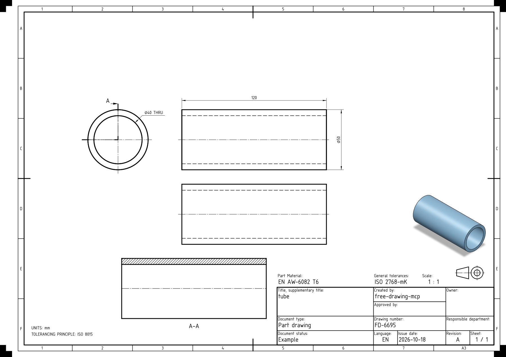
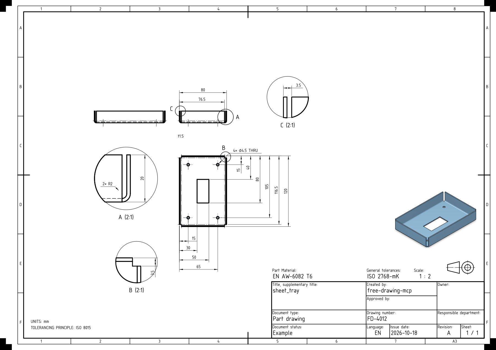
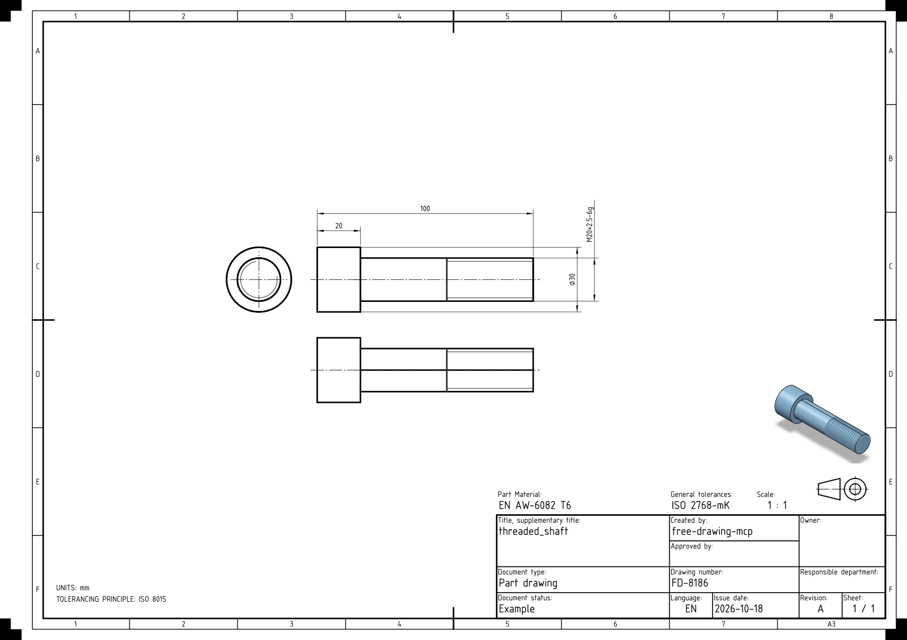
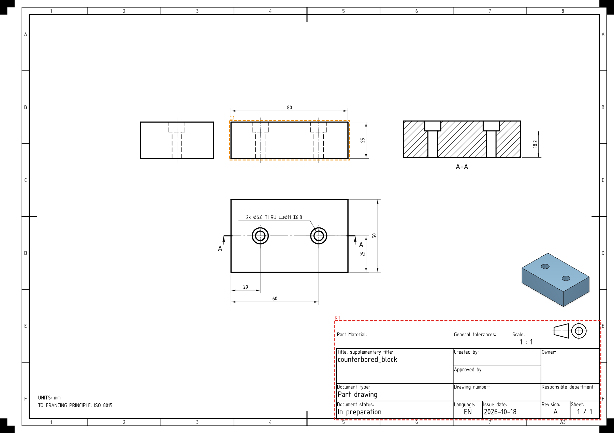
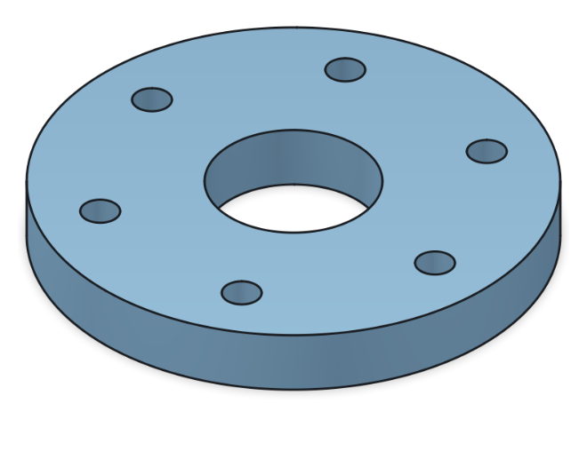
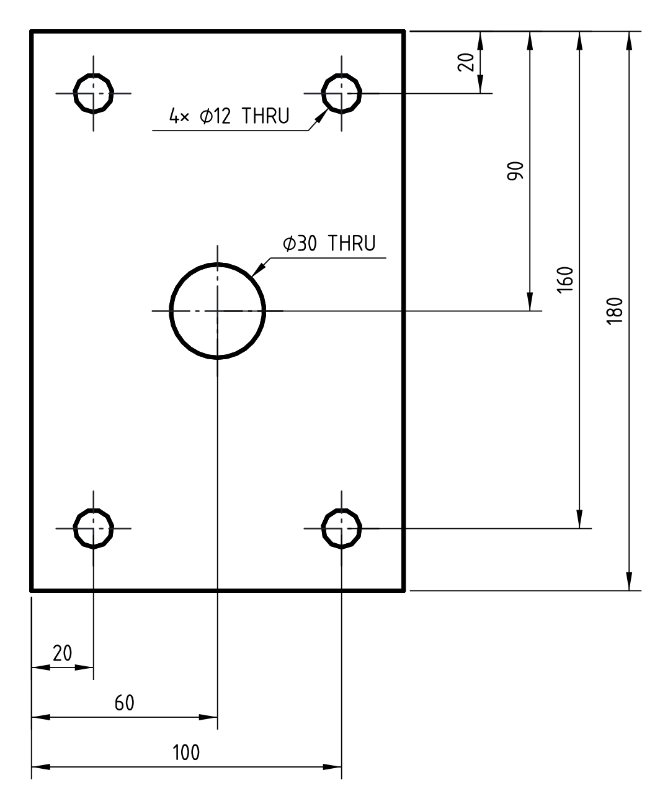
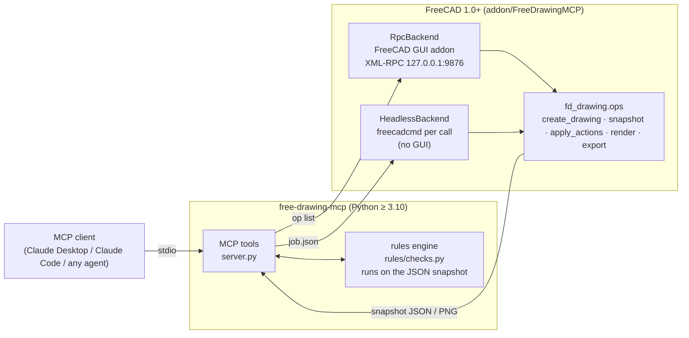

# free-drawing-mcp

**Create FreeCAD drawings from STEP geometry and inspect them against a Swiss SN EN ISO drafting checklist.**

free-drawing-mcp is a [Model Context Protocol](https://modelcontextprotocol.io) server plus a FreeCAD addon. It imports STEP, IGES, BREP or FCStd, selects and dimensions large standard views, and adds sections or details where needed. Defining views carry dimensions; a coloured isometric recognition view stays at the bottom right. It then inspects the sheet and reports automatic fixes or engineering review needs. Use it through an MCP client, the command line or headless FreeCAD. Generated drawings remain drafts until their geometry, manufacturing requirements and applicable standards have been reviewed.

## Desktop app

On Windows, double-click **Start Free Drawing.cmd**. Drop one `.step` or `.stp` file into the light, monochrome window, or select **SELECT FILE**. Drawing creation starts automatically, and the resulting TechDraw sheet opens in FreeCAD. The interface uses locally installed Futura fonts, with Arial as a fallback.

The app runs the local engine with automatic view selection, dimensioned views only, cut-face-only sections and safe layout adjustments. Each run saves the editable FCStd, a PDF, a preview and review notes in a new `Drawings/<part>-<timestamp>/` folder beside the input. The input and earlier drawings are preserved.

Progress and cancellation remain available while FreeCAD works. Missing material and tolerance values appear in review notes. If saved dimensions change on reopening, automatic opening stops and the app shows the integrity findings.

The launcher sets up its desktop dependencies through `uv` on first use. FreeCAD must already be installed. After setup, drawing creation runs locally without an AI service or MCP connection. You can also launch it from the repository:

```powershell
uv run --extra desktop free-drawing-ui
```

Optional overrides for unusual installations: `FREECADCMD` for the console executable and `FREECAD_GUI` for the desktop executable. Application error logs are saved under `%LOCALAPPDATA%/Free Drawing/desktop.log`.

The [Swiss TPD/GPS policy](guidelines/16-swiss-tpd-gps.md) governs new drawings. [Public reference downloads](guidelines/sources/README.md) include the Normen-Auszug 2026 reading sample and standards previews; they do not establish complete normative coverage.

Start with the [STEP-to-reviewed-drawing workflow](docs/step-to-reviewed-drawing.md). Agents can use the reusable [FreeCAD Swiss Drawings skill](skills/freecad-swiss-drawings/SKILL.md). Implementation findings and limitations are recorded in [engineering learnings](docs/freecad-drawing-learnings.md).


## Gallery

| | | |
|:-:|:-:|:-:|
|  |  |  |
| **Flange**: `6× ⌀9 THRU EQ SP` on a ⌀90 pitch circle, with 15 mm thickness dimensioned on an edge view | **Boss plate**: ⌀30 boss and `⌀16 THRU` bore, located from the datum edges; elevation and plan | **Tube**: end view plus profile with the axis horizontal, ⌀50 on the profile, `⌀40 THRU` on the circle |
|  |  |  |
| **Sheet metal**: standard views and a section with a 1.5 mm wall-thickness dimension | **Threaded shaft**: turned part with a thread callout | **Inspection**: findings boxed in red (fail) and orange (warn) |
|  |  | |
| **Isometric**: software-rendered, shaded with edges, 1 : 2 | **Dimension style**: thin lines, slim filled arrows, 3.5 mm text | |

Images are direct exports of the bundled sample parts. The plate, flange and tray examples come from the [reconstruction audit](docs/drawing-reconstruction-validation-2026-10-27.md); older examples come from `samples/run_samples.py`.

## Features

**Input: any STEP file**
- STEP AP203/AP214/AP242, IGES, BREP, or the largest solid in an `.FCStd`.
- **Rotated parts** are aligned to their own frame (largest planar faces, cylinder axis or inertia), so the principal views are true views. Your original object is not changed.
- **Assemblies** with several solids get a parts list (item names come from the STEP product structure, and identical parts are grouped) and one balloon per item.
- **Surface-only models**: closed shells are sewn into solids. Invalid B-reps are repaired with a warning. Inch files are converted to mm on import.

**Automatic view selection**
- The tool tries 6 front directions with 4 view sets (`Front`, `Front+Top`, `Front+Right`, `Front+Top+Right`). It keeps the **smallest view set that shows every feature characteristically**: holes where they appear as circles, faces where they are seen edge-on.
- Plates use a main view and a dimensioned edge view for thickness. Turned parts are drawn with the axis horizontal and diameters on the profile. Explicit `views` requests can override automatic selection.
- If a feature still can't be dimensioned, or would be dimensioned on a hidden line, the tool adds a view. Views that carry no unique dimension are removed.
- `dimensioned_only=True` is the default. Standard, section and detail views must carry dimensions. The coloured isometric is always retained as a recognition view at the bottom right, without dimensions. Undimensioned projection anchors remain hidden in the document so dependent dimensions stay valid.
- `section_cut_only=True` builds full sections from the exact material faces in the cutting plane. This removes projected geometry behind the cut. Existing full sections can be converted with a `set_view` action using `cut_only=True`.
- **First-angle** (ISO default) or **third-angle** projection. Standard views share the largest preferred scale that fits their complete annotation footprints, including enlargement. Automatic layout also tries a 90° group orientation for non-turned parts. Detail scales remain separately labelled.

**Feature-based dimensioning (ISO 129-1, [guideline 04](guidelines/04-dimensioning.md))**
- Positions are measured from datum planes as **baseline/ordinate stacks**: first line 10 mm from the outline, then 8 mm spacing, shortest dimension nearest the part.
- **Hole callouts** include multiplicity, through or depth, counterbore and countersink: `4× ⌀12 THRU`, `2× ⌀6.6 THRU ⌴⌀11 ↧6.8`, `⌵⌀12×90°`.
- **Bolt circles**: `6× ⌀9 THRU EQ SP`, plus a dash-dot ⌀ pitch circle.
- **Radii** are grouped (`4× R5`) and slot ends are located. Also covered: **chamfers** (`2× C1.5`), **angles** of inclined faces, spheres (`SR`), and native thickness dimensions on plate edge views.
- **Threads** get a callout when the thread is modelled. A plain tap-drill hole is reported for review (see [Limitations](#limitations)).
- Blind holes and one-sided counterbores/countersinks retain their entry direction. Opposite-face features get separate callouts and an additional projection when needed, including a rear view. Thread tolerance classes require explicit design input.
- Diameter witnesses stay within their cylinder's axial extent. Round outlines supply verified extremum references for baseline locations; concentric bosses share the enclosing cylinder's axis.
- The [machining feature validation](docs/production-drawing-validation-2026-10-29.md) records regression checks and a 12-drawing export audit.
- Each requirement is placed **once**, on visible geometry where any view offers it. A final dedupe pass removes repeated dimensions. Anything the tool could not place is reported, never silently dropped.
- Dimensions use 0.35 mm lines, 3 mm filled arrows and 3.5 mm `osifont` text in paper units. Layout never shrinks the text to fit. Collision checks include exported line extensions, angular arcs, radial shoulders and captions.
- Standard views carry the main dimensions. Strict automatic output uses at most one section for hidden/unplaced requirements and one detail for genuinely small features; undimensioned extras are hidden.
- Plate thickness uses a native dimension on an edge view at the shared standard-view scale. Sheet-metal wall thickness is dimensioned between actual wall faces, using a section when needed. A `t12` note cannot replace that dimension or view.
- See the [reference-project and dataset review](docs/drawing-reference-review-2026-10-26.md) for source comparisons, adopted approaches and the repeatable paired-STEP evaluation.

**Independent reconstruction check**
- Desktop creation, MCP `create_drawing`, and CLI `make` now run a bounded drawing-only reconstruction check for STEP inputs. It reads published dimensions, notes and drawn 2D geometry in a separate FreeCAD worker, exports a new STEP, and compares it with the original. Up to two visible repairs can add missing facts; the source STEP remains unchanged.
- It currently supports extruded rectangular/circular profiles, holes/counterbores, rectangular openings, slots, and dimensioned revolved profiles. Bends, assemblies, general blends and multi-axis definitions remain explicitly unverified rather than receiving a false pass.
- The default numerical comparison tolerance is 0.00001 mm. This is a verification precision, not a manufacturing tolerance. Checks include reprojection, solid validity/count, Boolean material differences, volume, bounds and sampled surface deviations.
- Each attempt keeps `drawing.json`, reconstructed FCStd/STEP files, comparison evidence and `verification.json`. Missing or unsupported facts are reported separately from layout findings. Native drawing evidence is supported; this is not a general scanned-PDF reconstruction tool.
- Audit an existing drawing with `verify_drawing_definition(doc, source, output_dir, max_repairs=0)`. Set `max_repairs=2` to allow visible repairs. CLI equivalent: `uv run python -m free_drawing_mcp.definition --drawing drawing.FCStd --source input.step --out verification`. Use `--max-repairs 0` for read-only work.
- See [the reconstruction design](docs/drawing-reconstruction-design.md) for the data boundary, supported scope and limitations. Automatic numeric labels retain up to six decimal places when needed, with trailing zeros removed.

**A complete sheet**
- ISO 5457 template (A4-A0) with a filled title block: title, scale, revision `A`, sheet `1 / 1`, date and the general tolerance.
- Default notes: `UNITS: mm` and `TOLERANCING PRINCIPLE: ISO 8015`. Tolerance values, material, surface finish and edge allowances require explicit design input. Legacy `ISO 2768-mK` is flagged for review.
- ISO 128 line weights: 0.7 mm visible, 0.35 mm hidden lines (always shown on orthographic views), and dash-dot centre lines on every cylinder.
- **Colour isometric** in the bottom-right zone, including with `dimensioned_only=True`. It normally uses 1 : 2, enlarges tiny parts for recognition, and reduces large parts to fit. It uses true B-rep normals, Phong shading, three-point lighting, supersampling and a contact shadow, with the edges drawn on top. Layout reserves its space above the title block.

**Inspection and fixes**
- Covers **every [CHECKLIST](guidelines/CHECKLIST.md) item A.1-P.5** in about 20 ms of pure Python on a JSON snapshot. FreeCAD isn't needed for this step.
- Machine-checkable items get PASS, FAIL or WARN. Purely visual items are marked **REVIEW** with a hint. Each FAIL or WARN carries **ready-to-apply action dicts**.
- **`autofix_drawing`** loop: it applies every fix that is safe without human input, re-inspects, and repeats.
- **Highlighted renders**: a PNG of the sheet with each finding boxed and labelled by rule id.

See [docs/inspection-rules.md](docs/inspection-rules.md) for every rule and [docs/dimensioning.md](docs/dimensioning.md) for the dimensioning engine.

## Architecture



- **`fd_drawing`** is the FreeCAD-side library. It runs inside FreeCAD and has these modules:
  - `importer`: import and repair the file, align the part, list assembly components
  - `analysis` and `features`: classify the part and list 3D dimensioning requirements
  - `planner`: choose views and realise each requirement on a view
  - `dimensions`: index view geometry, place stacks and leaders, dedupe
  - `builder`: one-shot drawing creation
  - `shaded`: software-rendered isometric
  - `snapshot`: JSON contract with the rules engine
  - `render`: schematic SVG/PNG/PDF renderer with highlights
  - `actions`: edits an agent applies
  - `ops`: operation registry
  - `runner`: headless entry point
- **Backends.** `RpcBackend` drives the addon in a running FreeCAD GUI: live documents, and TechDraw's own PDF/SVG export. `HeadlessBackend` runs each request in a fresh `freecadcmd` process against `.FCStd` files. Both call the same `fd_drawing.ops`, so they produce the same results. With `--backend auto`, each call uses the GUI when it's reachable and falls back to headless otherwise.
- **The rules engine** runs in the MCP server process on the snapshot JSON. This keeps inspect → fix → inspect cheap, and lets you inspect a saved snapshot without FreeCAD.

## Quick start

### Requirements

- [FreeCAD](https://www.freecad.org) **1.0 or 1.1** (TechDraw, plus `freecadcmd` for headless use)
- Python **≥ 3.10**
- [uv](https://docs.astral.sh/uv/) (recommended), or pip

### 1. Install the server

```bash
git clone https://github.com/TobiasKoehlerETH/free-drawing.git
cd free-drawing
uv sync                 # or: python -m pip install -e .
```

> The server finds the addon (`addon/FreeDrawingMCP`) and the guidelines (`guidelines/`) relative to the repository. Run it from the checkout with `uv --directory <repo> run …` or from an editable install. A plain non-editable wheel install cannot find them.

### 2. Install the FreeCAD addon

You need this only for the GUI backend. Headless mode loads the addon straight from the repository.

Copy or link `addon/FreeDrawingMCP` into FreeCAD's user `Mod` folder:

| OS | Mod folder (FreeCAD 1.1) | FreeCAD 1.0 |
|---|---|---|
| Windows | `%APPDATA%\FreeCAD\v1-1\Mod` | `%APPDATA%\FreeCAD\Mod` |
| Linux | `~/.local/share/FreeCAD/v1-1/Mod` | `~/.local/share/FreeCAD/Mod` |
| macOS | `~/Library/Application Support/FreeCAD/v1-1/Mod` | `~/Library/Application Support/FreeCAD/Mod` |

To find the exact folder, run `FreeCAD.getUserAppDataDir()` in FreeCAD's Python console and add `Mod`.

```powershell
# Windows (PowerShell): directory junction, no admin rights needed
New-Item -ItemType Junction -Path "$env:APPDATA\FreeCAD\v1-1\Mod\FreeDrawingMCP" -Target "C:\path\to\free-drawing-mcp\addon\FreeDrawingMCP"
```

```bash
# Linux / macOS
ln -s "$PWD/addon/FreeDrawingMCP" ~/.local/share/FreeCAD/Mod/FreeDrawingMCP
```

Restart FreeCAD, switch to the **Free Drawing MCP** workbench, and click **Start Drawing RPC**. The report view should show `Free Drawing RPC started on 127.0.0.1:9876`. To start the RPC with FreeCAD, turn on **Auto-start Drawing RPC**.

### 3. Or run headless (no GUI)

Just install FreeCAD. The server looks for `freecadcmd` on `PATH`, under `Program Files\FreeCAD*` / `%LOCALAPPDATA%\FreeCAD*` on Windows, in `/usr/bin`, and in the macOS app bundle. If it's somewhere else, set `FREECADCMD` or pass `--freecadcmd`.

```bash
uv run free-drawing-check make samples/parts/flange.step --png flange.png --backend headless
```

This writes `samples/parts/flange_drawing.FCStd` and prints the inspection report.

## MCP client configuration

**Claude Desktop** (`claude_desktop_config.json`, see [examples/claude_desktop_config.json](examples/claude_desktop_config.json)):

```json
{
  "mcpServers": {
    "free-drawing": {
      "command": "uv",
      "args": ["--directory", "C:/path/to/free-drawing-mcp", "run", "free-drawing-mcp", "--backend", "auto"],
      "env": { "FREE_DRAWING_TOKEN": "", "FREECADCMD": "" }
    }
  }
}
```

**Claude Code**: copy [examples/mcp.json](examples/mcp.json) to `.mcp.json` in your project, or run:

```bash
claude mcp add free-drawing -- uv --directory /path/to/free-drawing-mcp run free-drawing-mcp --backend auto
```

| Option | Env var | Default | Meaning |
|---|---|---|---|
| `--backend auto\|rpc\|headless` | `FREE_DRAWING_BACKEND` | `auto` | `auto` uses the GUI addon when reachable, otherwise headless |
| `--host` | | `localhost` | Host of the FreeCAD RPC |
| `--port` | `FREE_DRAWING_PORT` | `9876` | Port of the FreeCAD RPC |
| `--auth-token` | `FREE_DRAWING_TOKEN` | none | Bearer token for the RPC (prefer the env var) |
| `--freecadcmd PATH` | `FREECADCMD` | auto-detected | `freecadcmd` executable for the headless backend |
| `--only-text-feedback` | | off | Never return images (for clients without image support) |

## Tools

| Tool | What it does |
|---|---|
| `create_drawing(source, output?, template="A3", projection="first", scale="auto", title?, material?, drawing_number?, creator?, title_block?, notes?, views?, iso_color?)` | Builds the full drawing from a STEP/IGES/BREP/FCStd file and saves `<source>_drawing.FCStd`. Returns a summary, the inspection report and a highlighted preview. |
| `inspect_drawing(doc, page="auto", rules?, sections?, output="text"\|"json", render=False, verbose=False)` | Checks every checklist item A-P. Returns a compact text report or JSON findings. |
| `autofix_drawing(doc, rules?, max_passes=3, render=True)` | Applies every fix marked `auto`, re-inspects, and repeats. Reports the result before and after. |
| `apply_drawing_actions(doc, actions, inspect_after=True, render=False)` | Applies targeted edits, usually fixes copied from the report (see the action list below). |
| `render_drawing(doc, highlight=True, width=1800, source="auto"\|"schematic"\|"techdraw")` | Returns a PNG of the sheet with findings boxed and labelled. |
| `export_drawing(doc, format="pdf"\|"svg"\|"png"\|"dxf", path?)` | Exports the sheet. In the GUI, PDF and SVG come from TechDraw; elsewhere from the built-in renderer. DXF always comes from TechDraw. |
| `get_drawing_snapshot(doc, include_geometry=False)` | Returns the raw JSON the inspector works on: sheet, title block, views, dimensions, annotations and metadata. |
| `list_drawing_rules()` | Lists every checklist id, grouped by section. |
| `drawing_status()` | Shows which backend is in use, the FreeCAD and addon versions, and open documents. |
| `execute_code(code)` | Runs Python inside the FreeCAD GUI, for anything the tools don't cover. Works with the RPC backend only. |

**Resources:** `guideline://index` and `guideline://<name>`, for example `guideline://04-dimensioning` or `guideline://CHECKLIST`.
**Prompt:** `drawing_workflow(source)`.

**Actions** for `apply_drawing_actions`. All coordinates are page mm, origin bottom-left, Y up:
`move_view`, `move_group`, `move_dimension`, `set_dimension` (format, tolerances, `show_units`), `add_dimension` (`DistanceX|DistanceY|Diameter|Radius|Angle` on `VertexN`/`EdgeN` refs from the snapshot), `delete`, `set_title_block`, `add_note`, `set_note` (`append`, `x`, `y`), `set_view` (`hard_hidden`, `scale`, `caption`, direction), `add_centerlines`, `dedupe_dimensions`, `set_revision`.

## Agent workflow

```
create_drawing(source="part.step")      -> drawing + inspection + preview
inspect_drawing(doc)                    -> compact FAIL/WARN list, each with a numbered fix
autofix_drawing(doc)                    -> applies every 'auto' fix, re-inspects
apply_drawing_actions(doc, actions)     -> the rest (copy fixes, replace <placeholders>)
render_drawing(doc)                     -> look at REVIEW items on the image
export_drawing(doc, format="pdf")
```

Real report for `samples/parts/counterbored_block.step`, exactly as `create_drawing` and `inspect_drawing` return it:

```text
DRAWING CHECK  C:\Code\free-drawing\samples\out\counterbored_block.FCStd > Page  (A3 landscape · first-angle · 1 : 1)
RESULT FAIL · score 96/100 · 1 fail · 1 warn · 3 review · 39 pass · 40 n/a
FAIL   K.1   material not specified  -> fix 1 (needs input)
WARN   E.5   dimensions attached to hidden lines [Dimension005]
             hint: move them to a view where the feature is visible, or add a section
REVIEW (visual - check with render_drawing): C.1 front view shows the functional orientation; E.2 extension and dimension lines drawn cleanly; N.4 seating/sealing edges use explicit chamfer or radius
FIXES (apply_drawing_actions(actions=[...]); autofix_drawing applies every 'auto'):
  1 {"op": "set_title_block", "fields": {"part_material": "<material, e.g. EN AW-6082 T6>"}}
```

How the report reads:
- **RESULT** is `FAIL` if any check fails, `WARN` if any warns, otherwise `PASS`.
- **Score** = (pass + ½·warn) / (pass + warn + fail).
- Fixes marked **`auto`** are applied by `autofix_drawing`. Fixes marked **`needs input`** contain a `<placeholder>`. Ask the user (or use known data), then apply them:

```json
apply_drawing_actions(doc="…/counterbored_block_drawing.FCStd",
  actions=[{"op": "set_title_block", "fields": {"part_material": "EN AW-6082 T6"}}])
```

`inspect_drawing(..., output="json")` returns the same findings in machine-readable form: `rule`, `status`, `message`, `objects`, `bbox`, `fix`, `auto`, `hint`.

## Command line

`free-drawing-check` runs the same pipeline without an MCP client. The exit code is `1` when the result is FAIL.

```bash
free-drawing-check make part.step [-o part_drawing.FCStd] [--png preview.png] [--backend headless]
free-drawing-check inspect part_drawing.FCStd [--json] [--rules E.10 A.8]
free-drawing-check autofix part_drawing.FCStd [--png after.png]
free-drawing-check render  part_drawing.FCStd --png sheet.png
free-drawing-check snapshot.json            # inspect a saved snapshot, no FreeCAD needed
```

Prefix the commands with `uv run` if the environment isn't activated.

## Sample corpus and batch testing

`samples/generate_parts.py` builds a corpus of STEP parts (in `samples/parts/`), one per guideline family:
- plates with hole patterns and rounded corners
- a flange with a PCD
- turned shaft and tube
- L bracket, pocket, chamfers, slot, counterbores, stairs, wedge (30° face), boss plate, cross holes
- a two-solid assembly
- a 600 mm frame that forces a reduction scale
- an 8 mm pin
- sheet-metal channel, Z, hat, 135° angle, hemmed cover, tray and flanged U

```bash
python samples/run_samples.py                 # every part in samples/parts
python samples/run_samples.py --generate      # regenerate the parts first
python samples/run_samples.py flange tube     # only matching names
python samples/run_samples.py --extra D:/my/steps --jobs 4
```

For each part, the batch script creates the drawing headless, inspects it, and renders a highlighted PNG. It writes `samples/out/<part>.FCStd|.png|.report.txt`, plus `summary.md` and `summary.json`. Each part runs in its own `freecadcmd` process, so one bad file can't take the batch down.

The rules engine has unit tests on saved snapshots in `tests/fixtures/`. Run them with `uv run pytest`; add `-m "not freecad"` to skip tests that need a local FreeCAD.

## Coordinate conventions

- **Page frame**: every public API, action, snapshot field and highlight box uses millimetres, origin at the bottom-left of the sheet, Y up. Boxes are `[x0, y0, x1, y1]`.
- TechDraw also uses two internal frames: *view-local* (unscaled model mm centred on the view, Y up) and *dimension-internal* (scaled, Y down). `fd_drawing/geometry.py` converts between them explicitly, so you never need to.
- Dimension `x`/`y` in `move_dimension` and `add_dimension` is the label centre on the page.
- Model axes: rotated input is aligned so the part's own principal directions are X/Y/Z. Datums are the minimum faces of the aligned bounding box.

## Security

The XML-RPC server inside FreeCAD can run arbitrary Python (`execute_code`). It uses the following protections:

- It **binds to `127.0.0.1`** by default. Binding to all interfaces requires `"remote_enabled": true` in the settings file; turn that on only on a trusted network, and set a token.
- It **rejects browser requests**: any request with an `Origin` header gets 403, and any non-XML content type gets 415. This blocks CSRF and DNS-rebinding attacks from web pages.
- **Optional bearer token.** Put `"auth_token": "<secret>"` in `free_drawing_mcp_settings.json` in FreeCAD's user data directory (`FreeCAD.getUserAppDataDir()`). Give the MCP server the same value through `FREE_DRAWING_TOKEN`. Tokens are compared in constant time.
- The headless backend opens no network port. It talks to `freecadcmd` through a temporary job file.

## Limitations

- **The shaded isometric is a software render** (Python z-buffer, Phong shading), placed as a TechDraw image view. It looks right on the sheet and in exports, but it doesn't update when the model changes. Recreate the drawing to refresh it.
- **Two render paths.** In the GUI, `render_drawing` and `export_drawing` can use TechDraw's own SVG/PDF export. Headless, they use the built-in *schematic* renderer, which draws exactly what the snapshot contains (template, projected edges, dimensions, notes). It is very close to TechDraw but not pixel-identical. Line widths are also checked against TechDraw's line-group defaults when no GUI is running.
- **Threads** are dimensioned only when the thread is modelled as geometry. A hole at tap-drill size can't be told apart from a plain hole, so it is flagged for review rather than called out as `M…`.
- **Sections and details are generated automatically.** Principal full/half sections expose supported internal geometry; details enlarge small or crowded features. Dimensions are re-resolved against these views. Disable either with `sections=False` or `details=False`. View creation failures and lack of sheet space are reported. Auxiliary, broken, offset and broken-out views still require engineering work. Assembly sections require explicit component exclusions and hatch review.
- GD&T, surface symbols, welding symbols, heat treatment and revision balloons are not generated. The inspector checks them when present; many of these items are visual REVIEW items.
- Tolerances must be selected explicitly through title-block fields, notes and `set_dimension`. A bare ISO 22081 reference does not define a complete general specification. Inclined cylindrical and freeform surfaces are flagged where the automatic dimension model is incomplete.
- The title-block **material is never guessed**, so a fresh drawing always reports `K.1` "needs input" until you set it.

## Credits

- Built on [FreeCAD](https://www.freecad.org) TechDraw and the [MCP Python SDK](https://github.com/modelcontextprotocol/python-sdk).
- Drafting rules: see [`guidelines/`](guidelines/README.md) (ISO 128, 129, 1101, 2768, 5455, 5457, 8015 practice).

## License

[MIT](LICENSE) © 2026 Tobias Koehler. See [LICENSE](LICENSE) for the full notices.
