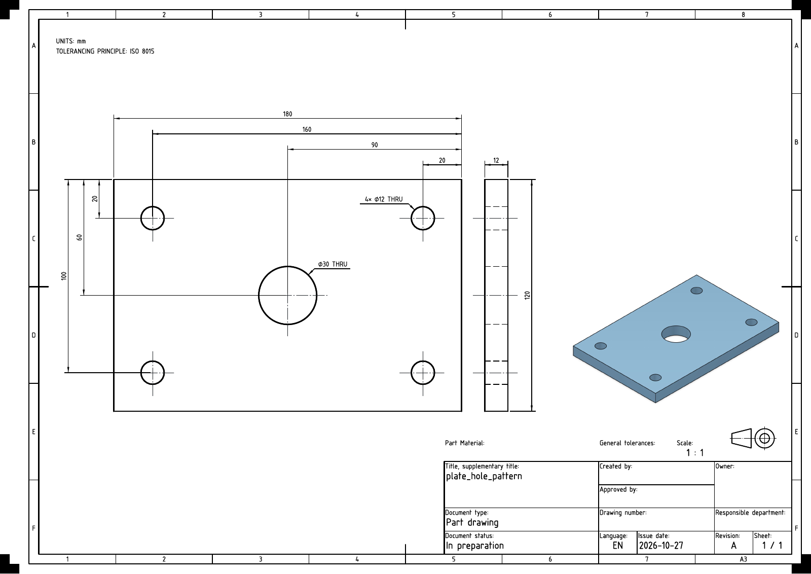

# Drawing reconstruction validation - 27 October 2026

The final run regenerated 18 distinct parts using a frozen engine: twelve local samples and six pinned Cadsy reference models. Nine drawings produced independent solids that matched their input STEP within the supported reconstruction scope. Nine remain unverified because their definitions need unsupported geometry or annotation interpretation.

The numerical comparison tolerance was **0.00001 mm**. It is not a manufacturing tolerance or a proof of uniqueness among all possible solids. The rebuilder received printed drawing evidence, not the source solid or its feature catalogue.

## Thickness is shown on a dimensioned view

The plate now has a native **12 mm** dimension on an edge view at the same scale as its main view. The flange, slotted plate and frame likewise retain dimensioned thickness views. The tray shows its **1.5 mm** wall thickness on a section through the actual faces. No standalone thickness notes occur in these 18 drawings.

The generator no longer drops a plate edge view in favour of a `t12` note. The repair loop adds a native thickness dimension and, if needed, a standard view. Inspection no longer accepts or automatically inserts thickness notes as substitutes. Tests delete the dimension and start with a missing edge view to exercise both repair paths.



## Verification results

- **269 tests verified across the full run and focused reruns**: all 37 real FreeCAD tests passed in the full run. Two historical fixture expectations were updated for the new thickness policy, after which all 232 Python and desktop tests passed. The final 4 mm placement fallback was checked by the native angle regression and the fresh 18-part audit. Two existing Qt deprecation warnings remain.
- All 18 drawings pass the seven view-policy checks: one coloured isometric at bottom right, clear of defining content, no dimensions on that isometric, dimensions on every defining view, shared standard-view scale, and bounded supplementary views.
- No E.10 text or dimension-line collision findings remain in the 18 final inspections. All exported PDFs were rendered with Poppler and visually reviewed.
- All source hashes are unchanged. Final drawing hashes match their verification reports. Frozen engine hashes match the current source files.
- 11 angular annotations were checked against their witness geometry. Arcs, arrows, extensions and full radial leaders participate in collision checks.
- Successful comparisons include reprojection against every defining view, solid validity and count, bounds, bidirectional Boolean differences, volume and sampled boundary deviations. Sampling is not a mathematical maximum-distance certificate.

| Part | Reconstruction | Standard scale | Dimensions | Sections / details |
| --- | --- | --- | --- | --- |
| cadsy_part_0001 | Unverified: unsupported definition | 1 : 1 | 25 | 0 / 0 |
| cadsy_part_0013 | Unverified: unsupported definition | 2 : 1 | 14 | 0 / 0 |
| cadsy_part_0026 | Unverified: unsupported definition | 1 : 2 | 35 | 0 / 0 |
| cadsy_part_0039 | Unverified: unsupported definition | 1 : 1 | 7 | 1 / 0 |
| cadsy_part_0052 | Unverified: unsupported definition | 1 : 2 | 23 | 0 / 0 |
| cadsy_part_0065 | Unverified: unsupported definition | 1 : 1 | 24 | 0 / 0 |
| counterbored_block | Matched within scope | 2 : 1 | 7 | 0 / 0 |
| flange | Matched within scope | 1 : 1 | 5 | 0 / 0 |
| large_frame | Matched within scope | 1 : 5 | 7 | 0 / 0 |
| micro_grooves | Matched within scope | 2 : 1 | 9 | 0 / 0 |
| mixed_assembly | Unverified: unsupported definition | 1 : 1 | 3 | 0 / 0 |
| plate_hole_pattern | Matched within scope | 1 : 1 | 11 | 0 / 0 |
| rotated_manifold | Unverified: unsupported definition | 1 : 1 | 13 | 1 / 0 |
| sheet_tray | Unverified: unsupported definition | 1 : 1 | 18 | 1 / 0 |
| slotted_plate | Matched within scope | 1 : 1 | 12 | 0 / 0 |
| tiny_pin | Matched within scope | 10 : 1 | 6 | 0 / 0 |
| tube | Matched within scope | 2 : 1 | 3 | 0 / 0 |
| turned_shaft | Matched within scope | 2 : 1 | 7 | 0 / 0 |

The slot and frame receive verified through-opening notes. The flange receives a bolt-circle start-angle note. These facts become visible on the drawing before the loop retries reconstruction. Thickness repairs use dimensions, never notes.

## Findings that remain open

The supported grammar covers dimensioned extrusions and revolved profiles. Assemblies, bends, general blends, multi-axis features and section/detail correspondence still need additional reconstruction support. An unsupported verdict must not be treated as complete geometric definition.

The external part `0052` still reports missing boss-centre locations, freeform definition and hidden-line dimension review. Part `0065` still reports inclined-face definition gaps. Part `0039` reports a requested detail that does not fit, although its double-ended countersinks now have correct through and both-sides callouts. The rotated manifold retains hidden-line review, with corrected blind-bore depth. Assembly presentation and part naming still need work. Some long extension lines and dense hidden-edge views remain review findings.

Material, general tolerances and functional manufacturing requirements were not supplied. All sheets remain **In preparation**. Passing reconstruction or layout checks is not manufacturing release approval.

View scales are the largest found by the bounded preferred-scale search with the current sheet margins and reserved space. This is not a proof of a global packing optimum. The isometric can use a different scale to remain recognizable.

## References and reproduction

The [reference-project and dataset review](drawing-reference-review-2026-10-26.md) records the online sources, pinned revisions and adopted approaches. Cadsy sheets are synthetic references, not certified professional manufacturing drawings. The [reconstruction design](drawing-reconstruction-design.md) describes the evidence boundary and supported grammar.

```powershell
uv run --group dev pytest -q
uv run python samples/audit_reconstruction.py --out samples/validation/new-audit --jobs 2
```

For a frozen run, copy `src` and `addon` to a new directory and pass that directory as `--engine`. Use a new output directory for every audit.

[Machine-readable results](drawing-reconstruction-validation-2026-10-27.json) include source and engine hashes, per-part findings and comparison measurements. Full local artifacts are under `samples/validation/reconstruction-complete-2026-10-27/`: each case has a PDF, PNG, editable FCStd, snapshots and attempt evidence. Successful cases also contain an independent STEP in the source coordinate frame. `review.html` is the local drawing gallery. Raw validation artifacts and downloaded references remain excluded from Git.
